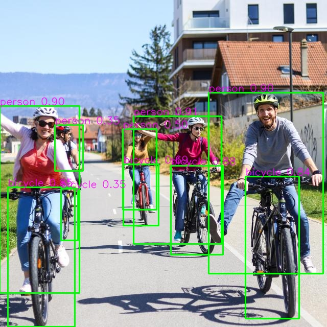
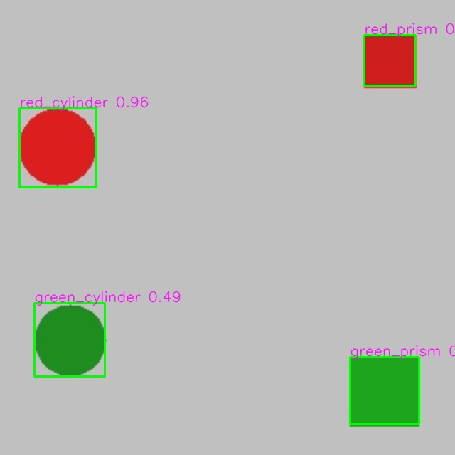

# Ubuntu 24.04 YOLOv8 학습 실습

[원문 설치 가이드](https://velog.io/@roboticsmaster/Ubuntu-24.04-YOLOv8-실습-설치-가이드)의 학습 흐름을 실행 가능한 스크립트로 새로 구현했습니다. 원문에서 언급한 배포 ZIP은 제공되지 않았으므로 그 ZIP의 코드나 12개 테스트를 복제한 저장소가 아닙니다.

## 30×30×60mm / Ø30×60mm 태그 퍽 통합 인식

새 실규격으로 빨강·초록 직육면체/원기둥을 생성하고 **YOLO 형상·색상 + CenterPose 물체 중심/자세 + AprilTag ID/위치**를 통합했습니다. 물체 중심과 표면 태그 위치는 별도로 출력합니다.

- [실행 방법·출력 규격·인쇄용 태그](docs/TAGGED_PUCKS.md)
- [최종 실규격 평가 결과](reports/tagged-pucks-v4/RESULTS.md)

태그 기본값은 tag36h11, 검은 경계 16mm, 흰 여백 포함 20mm, 윗면 중앙입니다. CenterPose는 NVIDIA DLA34 아키텍처의 맞춤 crop 학습 경로이며, 기본 Isaac ROS CenterPose 모델과 호환되는 export가 아닙니다. 실제 RealSense 성능 및 정밀 집기 정확도는 아직 검증하지 않았습니다.

## Isaac Sim 평가와 카메라 연결

실제 Isaac Sim 렌더 데이터로 50 epoch 학습과 전체 평가를 완료했습니다. 독립 시험 mAP50 **0.995**, mAP50–95 **0.973**, native Sim → Isaac ROS 카메라·검출 수신까지 확인했습니다.

- [전체 평가 결과와 근거](reports/SIM_EVALUATION.md)
- [Isaac Sim 데이터 생성·학습·영상 평가·ROS 실행](docs/ISAAC_SIM.md)
- [향후 Intel RealSense 연결·수집 방법](docs/REALSENSE.md) — 실제 장비 검증은 연결 후 진행

## 설치

Ubuntu 24.04 / Python 3.12 / NVIDIA GPU 기준입니다. Python venv와 시스템 라이브러리가 준비된 상태에서:

```bash
bash scripts/install.sh
source .venv-yolo/bin/activate
python scripts/check_gpu.py
```

가이드의 고정 조합인 **PyTorch 2.9.1 + torchvision 0.24.1 (cu128), Ultralytics 8.3.221, NumPy 1.26.4, OpenCV 4.11.0.86, ONNX 1.17.0**을 독립 `.venv-yolo`에 설치하고 전체 학습 파이프라인을 실제 GPU에서 검증했습니다. `environment-yolo-lock.txt`에 실제 설치 버전을 기록했습니다. 이전 cu130 재사용 환경은 `.venv-reused`에 별도로 보관하며 Git에는 포함하지 않습니다. 현재 검증 로그는 `reports/pipeline-guide.log`입니다.

## 전체 학습 예제

```bash
python -m unittest discover -s tests -v
python scripts/verify_pipeline.py
```

검증 스크립트는 공개 버스 이미지 검출, COCO8 1 epoch 학습, 합성 퍽 10 epoch 학습, 별도 test 평가, ByteTrack 영상 추적, COCO YOLOv8s 및 퍽 ONNX 변환, ONNX Runtime와 PyTorch의 출력 수치 비교를 수행합니다. 결과는 `reports/verification.json`, 상세 로그는 실행 시 리다이렉션할 수 있습니다. GPU와 인터넷 연결이 필요합니다. 결과 디렉터리는 Ultralytics가 자동 증가시킵니다. 검증 실행마다 `data/verification_<run_id>/`에 독립 합성 자료·설정·영상을 만들고, 기존 실제 데이터 설정은 덮어쓰지 않습니다. 합성 생성기를 따로 실행할 때는 `--output`, `--config`, `--video`로 새 경로를 지정할 수 있습니다. 기존 출력 경로가 있으면 중단합니다.

합성 퍽은 빨강/초록 원과 사각형으로 만든 **코드 흐름 확인용** 자료입니다. 원은 cylinder, 사각형은 prism을 대신하는 단순 도형이며 실제 물체 인식 성능을 증명하지 않습니다. train/val/test는 서로 다른 seed로 생성합니다. 실제 사진은 촬영 세션 단위로 분리해야 합니다.

## 실제 퍽 데이터 학습

`data/yolo/images/{train,val,test}`와 같은 구조의 `labels` 디렉터리를 준비하고, `configs/pucks.yaml`을 복사한 `configs/pucks-local.yaml`의 `path`를 데이터 절대 경로로 지정합니다. 이미지와 라벨 파일의 stem은 같아야 합니다. 클래스 순서는 red_cylinder, red_prism, green_cylinder, green_prism입니다. 라벨 검사기는 행의 숫자·범위·상자 경계를 검사합니다. 이미지 누락·촬영 세션 누출은 별도로 점검해야 합니다.

```bash
python scripts/validate_labels.py data/yolo/labels --classes 4
python scripts/train_yolo.py --data configs/pucks-local.yaml --epochs 50 --batch 4 --device 0
# 아래 경로는 콘솔에서 확인한 실제 출력 경로로 변경
export YOLO_WEIGHTS=runs/detect/pucks/weights/best.pt
yolo detect val model="$YOLO_WEIGHTS" data=configs/pucks-local.yaml split=test device=0
python scripts/track_yolo.py --weights "$YOLO_WEIGHTS" --source data/test.mp4 --device 0
python scripts/export_onnx.py --weights "$YOLO_WEIGHTS" --output models/pucks.onnx
python scripts/inspect_onnx.py models/pucks.onnx
```

기본 학습은 YOLOv8n, 640, seed 317, hue 증강 0입니다. ByteTrack ID는 일시적 번호이고 물리적 ID나 6D 자세가 아닙니다. 실영상·실제 퍽 데이터가 없어 실제 데이터 학습과 평가를 완료했다고 주장하지 않습니다.

## Isaac ROS / TensorRT

실제 설치: Isaac ROS 5.0.0 / ROS Lyrical, CUDA Toolkit 13.2.2, TensorRT 10.16.1.11. RTX 5060 Laptop GPU에서 컨테이너 GPU 인식, 두 모델의 엔진 생성, ONNX Runtime와 TensorRT 수치 비교를 검증했습니다. 기본 TF32 엔진은 엄격한 수치 비교에서 차이가 나서 재현 스크립트는 `--noTF32`로 생성합니다. 엔진은 대상 GPU에서 다시 만드세요.

호스트에서 공유 workspace를 준비합니다. `ISAAC_ROS_WS`는 본인의 실제 경로로 지정하세요. 이 장비의 프로젝트 경로는 `/home/seongmin/Projects/yolov8-ubuntu24-practice`이며, 공유 workspace는 프로젝트 내부의 `work/isaac_ros-dev`입니다.

```bash
export ISAAC_ROS_WS="$PWD/work/isaac_ros-dev"
mkdir -p "$ISAAC_ROS_WS/src" "$ISAAC_ROS_WS/practice"
python scripts/fetch_ros_assets.py "$ISAAC_ROS_WS"  # 최초 한 번, 기존 자산은 덮어쓰지 않음
cp -r scripts launch "$ISAAC_ROS_WS/practice/"
mkdir -p "$ISAAC_ROS_WS/isaac_ros_assets/models/"{yolov8,pucks}
cp models/yolov8s.onnx "$ISAAC_ROS_WS/isaac_ros_assets/models/yolov8/"
cp models/pucks.onnx "$ISAAC_ROS_WS/isaac_ros_assets/models/pucks/"
isaac-ros activate
```

Docker 및 NVIDIA Container Toolkit이 설치되어 있어야 합니다. 호스트 초기 설정은 `sudo isaac-ros init docker --yes`, `sudo nvidia-ctk runtime configure --runtime=docker`, `sudo systemctl restart docker`입니다. 실행 중 컨테이너가 없는 때 설정합니다.

활성화된 컨테이너에서:

```bash
cd /workspaces/isaac_ros-dev/practice
bash scripts/install_ros_packages.sh  # 새 컨테이너에 최초 한 번
bash scripts/build_engine.sh "$ISAAC_ROS_WS/isaac_ros_assets/models/yolov8/yolov8s.onnx" "$ISAAC_ROS_WS/isaac_ros_assets/models/yolov8/yolov8s.plan"
bash scripts/ros_preflight.sh
ROS_DOMAIN_ID=73 ROS_AUTOMATIC_DISCOVERY_RANGE=LOCALHOST bash scripts/run_ros_verification.sh --output "$ISAAC_ROS_WS/ros-verification" --seconds 30
```

자동 검증은 detector·rosbag·visualizer를 동시에 실행하고, 실제 검출 메시지와 결과 이미지를 저장한 뒤 자신이 실행한 프로세스를 종료합니다. RQT 창의 수동 조작 대신 이미지 토픽을 저장하여 확인했습니다. 개별 실행은 `bash scripts/run_ros.sh detect|bag|overlay|view`를 각각 별도 터미널에서 사용합니다.

### 4클래스 퍽 모델 연결

`launch/pucks.launch.py`는 입력 `images`, 출력 `output0`, 클래스 수 4, 입력 640×640을 명시합니다. COCO 라벨 대신 퍽 클래스명으로 표시합니다. 합성 test 이미지로 검증하며 실물 카메라 보정이나 실물 퍽 성능을 의미하지 않습니다.

```bash
# 컨테이너: 엔진 생성
bash scripts/build_engine.sh "$ISAAC_ROS_WS/isaac_ros_assets/models/pucks/pucks.onnx" "$ISAAC_ROS_WS/isaac_ros_assets/models/pucks/pucks.plan"
# 같은 ROS_DOMAIN_ID를 지정한 별도 터미널들에서 실행
ros2 launch ./launch/pucks.launch.py engine_file_path:="$ISAAC_ROS_WS/isaac_ros_assets/models/pucks/pucks.plan"
python3 scripts/publish_test_image.py /path/in/workspace/puck-test.jpg --image-topic /pucks/image --camera-topic /pucks/camera_info
python3 scripts/verify_ros.py --output "$ISAAC_ROS_WS/pucks-verification" --seconds 20 --image-topic /pucks/processed_image --detection-topic /pucks/detections
```

테스트 publisher는 입력 이미지를 640×640으로 resize하고 RGB 이미지와 같은 시각의 CameraInfo를 발행합니다. 출력 상자는 이 640×640 좌표계입니다. 실제 카메라에는 해상도와 calibration에 맞는 CameraInfo가 필요합니다. `scripts/compare_ros_boxes.py`로 같은 이미지의 PyTorch 상자와 ROS 상자를 비교할 수 있습니다. [NVIDIA decoder](https://github.com/NVIDIA-ISAAC-ROS/isaac_ros_object_detection/blob/release-5.0/isaac_ros_yolov8/src/yolov8_decoder_node.cpp)는 `cv::Rect<int>`에서 좌표와 크기를 절삭하므로, 같은 정수 변환을 적용한 기준으로 비교합니다. 소수점 기준의 원래 IoU도 보고서에 함께 남깁니다. `scripts/check_trt_output.py`는 동일 입력의 ONNX Runtime와 `trtexec --exportOutput` 결과를 비교합니다.

## 파일과 검증 증거

- `scripts/`: 설치, GPU/NMS 확인, 학습, 추적, 라벨 검사, 합성 자료, ONNX 검사 및 ROS 실행 도구
- `tests/`: 잘못된 라벨을 거부하는 회귀 테스트
- `reports/`: 실제 실행 기록과 완료된 단계의 수치
- `data/`, `datasets/`, `runs/`, `models/`: 재생성 가능한 로컬 산출물, Git 제외

공식 API 참고: [학습](https://docs.ultralytics.com/modes/train/), [추적](https://docs.ultralytics.com/modes/track/), [ONNX export](https://docs.ultralytics.com/modes/export/). 모델은 YOLOv8을 명시합니다. 외부 모델·데이터·패키지는 각각의 라이선스가 적용됩니다.

## 실제 검증 결과

- 고정 버전 GPU 학습·추적·ONNX: 통과 (`reports/verification.json`)
- 공식 ROS: 30초 동안 검출 메시지 271개, 결과 영상 프레임 65개
- 퍽 ROS: 20초 동안 검출 메시지 195개, 프레임당 4개 객체, 결과 영상 프레임 11개
- 퍽 상자 좌표: decoder 정수 변환 기준 4개 모두 IoU 1.0
- 합성 test mAP50: 0.995. 실제 퍽 사진 성능을 의미하지 않습니다.





기존 검증 로그의 호스트 경로는 프로젝트 이동에 맞춰 정규화했습니다. 측정값과 모델 파일은 변경하지 않았습니다.
