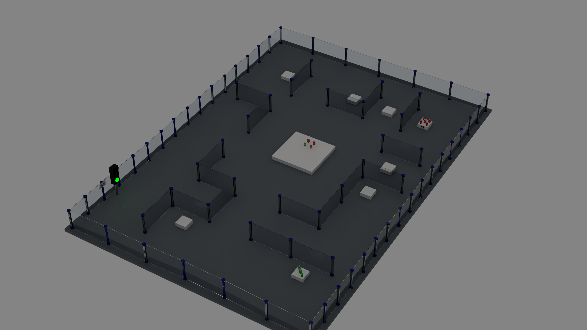
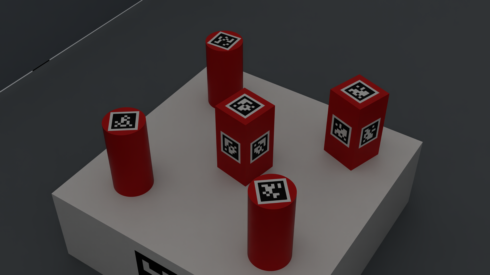

# 미로 미션 반복 생성과 학습 자료 만들기

사용자가 제공한 `maze.zip`의 `maze.usda`와 `geo.usd`를 참조합니다. 원본 벽과 기둥 좌표는 변경하지 않습니다. 생성된 장면에는 로봇이 없습니다. 작업대 12개, 퍽 12개, 장소 태그, Code128 바코드, 신호등, 조명, 카메라를 추가합니다.

## 1. 첫 실행: 10회차 만들기

```bash
cd /home/seongmin/Projects/yolov8-ubuntu24-practice
./scripts/create_mission_batch.sh \
  --output work/mission-10 --episodes 10 --seed 2000000
```

처음 실행하면 `~/Downloads/maze.zip`에서 필요한 두 파일만 `work/mission-inputs/maze/`에 풉니다. 출력 폴더가 이미 있으면 덮어쓰지 않습니다. 새 이름을 사용하세요. 필요한 추가 패키지는 Isaac Sim 환경의 `reportlab`입니다.

```bash
/home/seongmin/isaacsim6_venv/bin/pip install reportlab
```

결과:

```text
work/mission-10/
  index.json
  episode-00000/
    mission.json     # 속성, 초기 자세, 신호, 바코드, 정답 배치
    scene.usda       # Isaac Sim으로 열 장면
  episode-00001/
    ...
```

`scene.usda`는 원본 맵을 상대 경로로 참조합니다. 다른 컴퓨터로 옮길 때는 원본 두 파일도 함께 옮기고 같은 상대 경로를 유지하거나 다시 생성하세요. 원본 CAD 자료는 Git 저장소에 포함하지 않습니다.

## 2. 무엇이 랜덤인가

- R/Y/G 신호 횟수: 각각 1~6, 합계 12인 **25가지 순서 있는 조합**.
- 신호 순서: 정해진 개수의 R/Y/G를 12회 순서로 섞음.
- 바코드: `P2-01`~`P2-04`. 01/03 오름차순, 02/04 내림차순. 동률은 항상 R→Y→G.
- 퍽: 빨강/초록, 직육면체/원기둥, ID 0~11, 시작 박스 배정, Z축 회전각.
- 정답: 각 그룹에 들어가는 ID와 주사위 자리 할당, 최종 Z축 회전각.
- 환경: 조명 세기·색온도, 아크릴 거칠기, 시작 박스를 보는 카메라 위치.

먼저 가능한 퍽 구성을 만들고, 독립적인 조합 탐색으로 Y 그룹이 한 모양인지, 남은 퍽이 R/G 수량을 채우는지 다시 확인합니다. 전역 12개 ID를 한 번씩만 사용합니다. 분포는 풀이 가능한 문제를 만드는 절차적 분포이며 모든 퍽 구성에 대한 균등 추출은 아닙니다.

공식 모드에서는 시작 박스 6곳과 박스별 X±40mm 위치가 고정입니다. 위치를 임의로 바꿔 공식 규칙을 위반하는 대신, 그 자리에 놓이는 퍽과 방향을 바꿉니다. 주사위 눈의 점 위치도 고정입니다. 2·3의 대각선이나 6의 두 열을 회전시키지 않습니다.

## 3. 모든 횟수·바코드 조합 만들기

```bash
./scripts/create_mission_batch.sh \
  --output work/mission-all --all-combinations --seed 3000000
```

25 × 4 = **100회차**입니다. `--all-combinations`는 `--episodes`보다 우선합니다. 모든 신호 순열이나 모든 퍽 자세를 완전 열거하는 옵션은 아닙니다. 시드를 바꿔 반복하면 같은 횟수 조합에서도 다른 퍽과 자세가 나옵니다.

## 4. 눕힌 퍽 등 인식 증강

```bash
./scripts/create_mission_batch.sh \
  --output work/mission-aug --episodes 100 --seed 4000000 \
  --pose-mode augmentation --jitter-mm 3
```

직육면체는 여러 면으로 눕히거나 뒤집고, 원기둥은 세우거나 눕힙니다. 바닥이 작업대 위에 닿도록 중심 높이를 계산하며, 임의의 공중 기울기는 만들지 않습니다. `jitter-mm`은 초기 XY에 최대 ±3mm 변동을 줍니다. 퍽 사이 간섭은 보수적인 XY 반경으로 검사합니다.

**공식 미션은 바닥 70mm·윗면 130mm인 세운 퍽을 요구합니다.** 눕힌 자세나 위치 흔들기는 인식 학습용이며 `official_compliant=false`로 기록됩니다. 동적 마찰·굴러감 검증은 포함하지 않습니다. 퍽은 정적인 충돌체입니다.

## 5. 완성된 주사위 배치도 생성

```bash
./scripts/create_mission_batch.sh \
  --output work/mission-solved --episodes 10 --seed 2000000 \
  --layout solution
```

1번과 같은 시드라면 동일한 문제의 초기 장면/정답 장면을 각각 만들 수 있습니다. 정답 장면에서는 목적지 L1/L2/L3에 12개가 동시에 놓입니다. 이는 정답 시각화와 인식 학습을 위한 장면이며 로봇이 이동·집기·놓기를 수행했다는 의미는 아닙니다. 실제 로봇 성공률·안정 유지 시간은 별도 검증해야 합니다.

## 6. 실제 4K 렌더링과 자동 라벨

```bash
OMNI_KIT_ACCEPT_EULA=YES /home/seongmin/isaacsim6_venv/bin/python \
  sim/render_mission.py work/mission-10/episode-00000/scene.usda \
  --camera Overview,Signal,Pucks1 --output work/mission-preview
```

기본 3840×2160이며 `--width 1280 --height 720`으로 학습용 렌더 비용을 줄일 수 있습니다. 생성물은 `images/*.png`, `labels/*.txt`, `manifest.json`입니다. 라벨은 RTX의 실제 카메라 가시 경계 상자를 YOLO 형식으로 변환합니다. 가려진 물체는 없거나 잘린 경계 상자로 나올 수 있습니다. 클래스 순서는 아래와 같습니다.

```text
0 red_cylinder
1 red_prism
2 green_cylinder
3 green_prism
```

배치 전체를 한 프로세스에서 렌더링:

```bash
OMNI_KIT_ACCEPT_EULA=YES /home/seongmin/isaacsim6_venv/bin/python \
  sim/render_mission.py work/mission-10 \
  --camera Pucks1,Pucks2,Pucks3,Pucks4,Pucks5,Pucks6 \
  --width 1280 --height 720 --output data/mission-train-render
```

정답 장면에서는 `--camera L1,L2,L3`를 사용하세요. `--gui`로 실행하면 렌더 이후 창을 유지합니다. GUI의 재생 버튼으로 신호등 타임라인을 볼 수 있습니다. `--frame 24`는 1초 시점입니다. 24fps에서 1초 켜짐/1초 꺼짐을 반복하고 마지막 12번째 점등 뒤 3초 꺼짐으로 총 26초입니다. 프레임 0부터 첫 점등이 시작됩니다.

직육면체는 6면 모두 동일 ID, 원기둥은 윗면에 태그를 붙입니다. 퍽 태그 검은 외곽 한 변 16mm/흰 여백 포함 20mm, 장소 태그 48mm/60mm입니다. ID는 색을 영구 지정하지 않습니다. `mission.json`이 그 회차의 속성 등록표입니다.

YOLO 라벨과 별도로 `mission.json`에는 3D 위치와 자세 정답이 있습니다. **기존 CenterPose 학습기의 데이터 포맷으로 변환된 자료는 아닙니다.** CenterPose 학습에 쓰려면 카메라 보정값과 카메라 좌표계 변환·코너 투영을 추가로 연결해야 합니다.

## 7. train/val/test 분리

서로 다른 시드 범위로 세 번 생성하고 각각 렌더링하세요. 같은 회차의 다른 카메라나 초기/정답 장면을 서로 다른 split으로 나누면 데이터 누수가 생깁니다.

예: train=2000000부터, val=2100000부터, test=2200000부터. 회차 수가 범위를 넘지 않게 설정합니다. 결과 `images/labels`를 각각 기존 데이터셋의 `images/train`, `labels/train` 등에 배치하고 `data.yaml`의 4개 클래스 순서를 위와 맞추세요. 마지막 test는 튜닝 중 사용하지 않습니다. 이 스크립트는 자료를 생성하며 기존 모델 학습을 자동 실행하지 않습니다.

## 8. 바꿀 코드와 미확정 치수

| 항목 | 수정 위치 |
|---|---|
| 시작 박스·목적지 좌표 | `scripts/randomize_mission.py`: `STARTS`, `GOALS` |
| 주사위 눈의 방향·60mm 간격 | 같은 파일의 `DICE` |
| 퍽 자세/색상/모양 분포 | 같은 파일의 `episode()` |
| 맵 좌표 보정 | 실행 인자 `--map-offset-mm X Y` |
| 재질·조명·카메라·장치 형상 | `sim/mission_scene.py`: `build_scene()` |
| RGB/YOLO 라벨 저장 | `sim/render_mission.py` |

원본 맵은 중심 근처가 원점이며, PDF는 왼쪽 아래 기둥 중심이 원점입니다. 기본 변환은 `[-2202,-3152]mm`로 **추정**했습니다. 맵 메시를 늘리거나 벽 위치를 바꾸지는 않습니다. 원본 전체 외곽 경계는 약 4565×6462mm로, PDF 경기장 치수와 같지 않습니다. 부속품 돌출과 좌표 차이가 있어 실제 기준점 측량 없이 정확한 일치를 단정할 수 없습니다.

중앙 받침대 중심 Y=3500mm, 신호등 본체/렌즈 높이와 크기, 바코드 인쇄 크기, 실내 조명은 자료에 없는 **모델링 가정**입니다. 실제 측정값에 맞게 조정하세요. 투명 아크릴은 OmniGlass, 굴절률 1.491, 유한 두께, RTX 반사·투과를 사용합니다. 벽 형상과 두께는 제공 USD를 그대로 사용합니다. 실제 조명·스크래치·센서 노이즈를 계측해 보정한 광학 디지털 트윈은 아닙니다.

## 9. 검증

```bash
python3 -m unittest discover -s tests -p test_mission_randomization.py -v
```

모든 100개 횟수/바코드 조합, 동률 순서, 불가능한 할당 거부, 시드 재현, 공식/증강 각각 1000회차의 ID·수량·그룹·충돌 간격을 검사합니다. 원본 파일은 읽기 전용 참조이고, 새 출력 폴더에만 생성합니다.

현재 검증 결과: 전체 33개 테스트 통과, 공식/증강 2,000회차 검사, 신호등 625프레임 상태 검사, Code128 네 코드의 생성·역판독 검사 완료. 실제 RTX 4K 렌더에서 완성 배치 3/4/5개의 YOLO 경계 상자와 총 12개 퍽 ID를 확인했습니다. 서로 다른 두 회차의 근접 영상과 바코드 판독도 확인했습니다. 상세 수치는 [검증 JSON](../reports/mission-environment/validation.json)에 있습니다.




