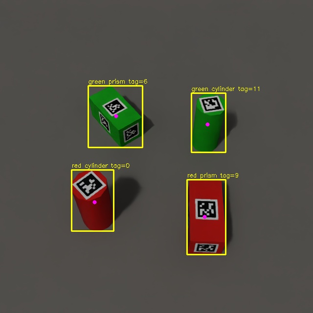

# 눕힌 직육면체 6면 동일 ID: 보강 결과와 실행

후속 [v2 정확도 개선 모델](SIX_FACE_V2.md)이 추가됐습니다. 이 문서는 v1 기록입니다.

2026-10-29 보강 완료. 직육면체는 여섯 면 중앙에 같은 tag36h11 ID, 원기둥은 윗면 한 장을 사용합니다. 서로 다른 물체에는 다른 ID를 사용합니다. 검은 경계 16mm, 흰 여백 포함 20mm입니다.

## 선택된 모델

- YOLO: `runs/detect/tagged-sixface-reinforced-20261029/weights/best.pt`
- CenterPose: `models/centerpose-sixface-reinforced-20261029/best.pt`
- 새 Sim 데이터: `data/tagged-sixface-20261029/`
- 학습 구성: `data/tagged-sixface-mixed-20261029/` (기존 train 400장 + 새 train 1200장)
- 검증 200장, 시험 300장은 모두 기존 학습에 없던 seed이며 split 간 seed 중복 0개.

모델·데이터는 현재 컴퓨터에 있으며 Git에는 포함하지 않습니다. [실험 기록](../reports/reinforcement-20261029/README.md)과 [파일 해시](../reports/reinforcement-20261029/SHA256SUMS)를 참고하세요.

## 동일한 새 300장 시험 비교

| 지표 | 보강 전 모델 | 보강 후 모델 |
|---|---:|---:|
| 물체 정답 수 | 1088 | 1088 |
| YOLO 정답 매칭 | 1085 | 1085 |
| CenterPose 유효 출력 | 1080 | 1084 |
| 중심 오차 중앙값 | 3.98mm | 2.18mm |
| 중심 오차 P95 | 25.19mm | 9.84mm |
| 올바른 물체–태그 연결 | 766 | 985 |
| 잘못된 물체–태그 연결 | 0 | 0 |

YOLO 모델 선택에 사용한 **val** mAP50–95는 0.97888 → 0.99363입니다. test 매칭 수는 mAP가 아니며 서로 다른 지표입니다. CenterPose 중심 오차는 유효한 출력에 한정됩니다.

태그 검출기는 학습하지 않았습니다. 같은 새 6면 시험 자료에서 두 모델 모두 태그 ID 1015/1088개(93.29%)를 검출했고, 장면 정답에 없는 ID는 0개입니다. 태그 위치 오차 중앙값 7.93mm/P95 15.86mm입니다. 예전 한 면 자료의 58.58%와는 태그 배치·시험 장면이 달라 직접적인 학습 전후 비교가 아닙니다.

클래스별 태그 검출: 빨간 원기둥 260/272, 빨간 직육면체 224/272, 초록 원기둥 267/272, 초록 직육면체 264/272. 가림·시점·조명에 따른 미검출은 남아 있습니다. 이번 시험은 새 seed의 절차적 Sim 자료이며 실물 카메라 정확도는 아직 검증하지 않았습니다.

## 한 장 실행

```bash
cd /home/seongmin/Projects/yolov8-ubuntu24-practice
source .venv-yolo/bin/activate
python scripts/tagged_perception.py \
  --image data/tagged-sixface-20261029/images/test/0001.png \
  --manifest data/tagged-sixface-20261029/manifest.json \
  --yolo runs/detect/tagged-sixface-reinforced-20261029/weights/best.pt \
  --centerpose models/centerpose-sixface-reinforced-20261029/best.pt \
  --output "reports/sixface-demo-$(date +%Y%m%d-%H%M%S)"
```



`objects[].apriltag`는 같은 ID의 여러 면 중 가장 큰 영상 면적의 대표 태그입니다. 모든 검출 면은 `tags`에 남습니다. 물체 ID가 같아도 면마다 태그 위치·회전은 서로 다릅니다.

**같은 ID만으로는 어느 면인지 알 수 없습니다.** 태그에서 단일 물체 중심을 확정하지 않고 `tag_derived_object_center_camera_m: null` 및 15.03mm/30.03mm 법선 이동 후보를 반환합니다. 물체 중심은 별도의 `centerpose.center_camera_m`를 사용합니다. 후보를 임의로 정답으로 취급하지 마세요. 고유한 물체 회전각도 대칭 때문에 모호하며 면 식별 또는 추가 보정이 필요합니다.

## 실시간 실행

터미널 A:

```bash
cd /home/seongmin/Projects/yolov8-ubuntu24-practice
OMNI_KIT_ACCEPT_EULA=YES /home/seongmin/isaacsim6_venv/bin/python \
  sim/live_ros_camera.py --scene data/tagged-sixface-20261029/scene.usda \
  --seconds 180 --domain 77 --output "reports/sixface-camera-$(date +%Y%m%d-%H%M%S).json"
```

카메라가 준비된 뒤 터미널 B:

```bash
cd /home/seongmin/Projects/yolov8-ubuntu24-practice
ROS_DOMAIN_ID=77 bash scripts/run_live_tagged.sh \
  --yolo runs/detect/tagged-sixface-reinforced-20261029/weights/best.pt \
  --centerpose models/centerpose-sixface-reinforced-20261029/best.pt \
  --prism-tag-mount six_faces --seconds 60 \
  --output "reports/sixface-live-$(date +%Y%m%d-%H%M%S)"
```

## 새 자료 생성과 재학습

현재 생성기는 직육면체를 눕힙니다. 새 실행에서는 기존 seed 구간과 겹치지 않는 `--seed-base` 및 새 output 이름을 선택하세요.

```bash
OMNI_KIT_ACCEPT_EULA=YES /home/seongmin/isaacsim6_venv/bin/python \
  sim/generate_tagged_pucks.py --output data/tagged-sixface-next \
  --train 1200 --val 200 --test 300 --video-frames 120 \
  --prism-tags six_faces --seed-base 400000
```

보강 실행 순서·학습률은 [run-training.sh](../reports/reinforcement-20261029/run-training.sh)에 기록했습니다. 이 파일은 완료된 실험의 경로가 고정된 재현 기록이므로 그대로 다시 실행하면 기존 출력 폴더 검사에서 중단됩니다. 새 이름과 실제 경로를 정해 복사·수정한 후 사용하세요.

기존 `data/tagged-test`의 8000/1000/1000 생성은 seed 구간이 겹쳤습니다. 해당 수치를 독립 시험으로 사용하지 마세요. [중복 감사](../reports/reinforcement-20261029/baseline-audit.json), [수정 후 감사](../reports/reinforcement-20261029/split-audit.json)에 근거를 남겼습니다.

실시간 Sim 검증에서는 376개 동기화 프레임, 1504개 물체 모두에서 유효 CenterPose와 태그 연결을 확인했습니다. 이는 고정 장면의 통신·출력 확인이며 정확도는 위 300장 시험으로 평가했습니다. [수신 보고서](../reports/reinforcement-20261029/live/live-report.json)
