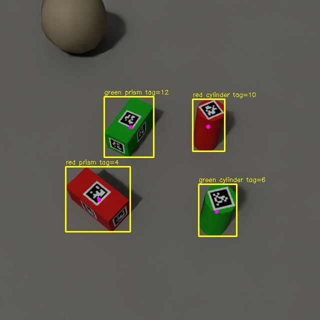

# 6면 동일 ID 태그 v2 — 추가 정확도 개선

2026-10-29, v1 이후 추가 보강을 완료했습니다. 직육면체는 눕힌 상태로 여섯 면에 같은 ID, 원기둥은 윗면 한 장입니다. 물체 간 ID는 다릅니다.

## 무엇이 개선됐는가

v1과 v2를 **새로 생성한 동일한 test 300장**에 적용했습니다. 이전 보고서의 300장과는 다른 seed이므로 이전 표의 수치와 직접 차감하지 마세요. 모델 선택에는 고정 val 200장만 사용했습니다.

| 지표 | v1 | v2 |
|---|---:|---:|
| 정답 물체 | 1088 | 1088 |
| 유효 CenterPose | 1077 | 1080 |
| 중심 오차 중앙값 | 2.14mm | **1.83mm** |
| 중심 오차 P95 | 11.16mm | **9.73mm** |

중앙값 약 14.5%, P95 약 12.9% 감소입니다. 오차는 유효 출력에 한정됩니다. 아직 P95가 약 10mm이므로 모든 물체가 2mm 이내라는 의미가 아닙니다. 실제 카메라·로봇 집기 정확도는 미검증입니다.

새 CenterPose는 추가 Sim train 800장을 포함한 2400장으로 20 epoch 미세조정했습니다. cosine learning-rate decay와 3중 crop 추론을 사용합니다. bbox 크기를 0.9/1.0/1.1배로 바꾸어 예측한 코너를 대칭에 맞춰 정렬·평균낸 뒤 PnP를 계산합니다. 새 모델의 기본 출력이 유효하지 않을 때만 패키지에 포함된 v1 모델을 사용합니다. 최종 test에서는 2개 물체에서 이 보완 경로가 사용됐습니다.

**연산량과 모델 메모리는 증가합니다.** 보통 최대 3회 CenterPose 네트워크 추론이 필요하며 v1 가중치도 메모리에 유지합니다. 높은 처리율이 더 중요하면 기존 v1 체크포인트를 사용할 수 있습니다. `best-tta-fallback.pt` 내부 설정을 `load_model()`이 자동 적용하므로 별도 TTA 실행 옵션은 없습니다.

YOLO 추가 학습은 val mAP50–95 0.99348로 기존 0.99363을 넘지 못해 **v1 YOLO를 유지**했습니다. 태그 확대·코너 보정·PnP 보정도 검증 위치 오차가 악화돼 채택하지 않았습니다. 개선된 기능과 유지한 기능을 구분해야 합니다.

최종 test의 태그 ID 검출은 1011/1088(92.92%), 예상하지 않은 ID는 0개입니다. 물체–태그 연결은 982개 모두 정답입니다. 태그 자체 위치 오차는 중앙값 8.23mm/P95 16.45mm이며 v1과 같은 계산 방법입니다. 6면 동일 ID의 면 식별 모호성과 회전 대칭은 여전히 남습니다.

## 사용할 파일

| 용도 | 로컬 경로 |
|---|---|
| YOLO | `runs/detect/tagged-sixface-reinforced-20261029/weights/best.pt` |
| CenterPose v2 | `models/centerpose-sixface-v2-20261029/best-tta-fallback.pt` |
| 새 시험 데이터 | `data/tagged-sixface-v2-20261029/` |
| 혼합 학습 설정 | `data/tagged-sixface-v2-mixed-20261029/` |
| 전체 평가 기록 | `reports/refinement-v2-20261029/` |

모델·데이터는 이 컴퓨터에 저장되며 Git에는 포함하지 않습니다. [해시](../reports/refinement-v2-20261029/SHA256SUMS), [모델 선택 근거](../reports/refinement-v2-20261029/centerpose-selection.json), [실험 상세](../reports/refinement-v2-20261029/README.md)를 참고하세요.

## 한 장 실행

```bash
cd /home/seongmin/Projects/yolov8-ubuntu24-practice
source .venv-yolo/bin/activate
python scripts/tagged_perception.py \
  --image data/tagged-sixface-v2-20261029/images/test/0001.png \
  --manifest data/tagged-sixface-v2-20261029/manifest.json \
  --yolo runs/detect/tagged-sixface-reinforced-20261029/weights/best.pt \
  --centerpose models/centerpose-sixface-v2-20261029/best-tta-fallback.pt \
  --output "reports/sixface-v2-demo-$(date +%Y%m%d-%H%M%S)"
```



기존 실행 명령에서는 `--centerpose`만 새 모델로 바꾸면 됩니다. 6면 모드는 이미지 manifest의 `prism_tag_mount`로 결정됩니다. 태그 중심과 물체 중심은 다르며, 물체 중심은 `centerpose.center_camera_m`를 읽습니다. 태그가 어느 면인지 모르면 `tag_derived_object_center_camera_m`는 null입니다.

## Sim 실시간 실행

터미널 A:

```bash
cd /home/seongmin/Projects/yolov8-ubuntu24-practice
OMNI_KIT_ACCEPT_EULA=YES /home/seongmin/isaacsim6_venv/bin/python \
  sim/live_ros_camera.py --scene data/tagged-sixface-v2-20261029/scene.usda \
  --seconds 180 --domain 78 --output "reports/v2-camera-$(date +%Y%m%d-%H%M%S).json"
```

카메라 준비 후 터미널 B:

```bash
cd /home/seongmin/Projects/yolov8-ubuntu24-practice
ROS_DOMAIN_ID=78 bash scripts/run_live_tagged.sh \
  --yolo runs/detect/tagged-sixface-reinforced-20261029/weights/best.pt \
  --centerpose models/centerpose-sixface-v2-20261029/best-tta-fallback.pt \
  --prism-tag-mount six_faces --seconds 60 \
  --output "reports/v2-live-$(date +%Y%m%d-%H%M%S)"
```

학습을 이어갈 때는 v2의 원본 `best.pt`를 시작 가중치로 사용할 수 있습니다. TTA/보완 모델 패키지는 최종 추론용입니다. 추가 데이터는 기존 train과 섞되 val/test를 학습에 넣지 말고 별도 seed 구간을 사용하세요.

실시간 Sim 검증에서는 동기화 390프레임, 물체 1560개 모두에서 유효 CenterPose와 태그 연결이 출력됐습니다. 이 수치는 통신·출력 확인이며 mm 정확도는 위 시험 자료로 평가했습니다. [수신 보고서](../reports/refinement-v2-20261029/live/live-report.json)
