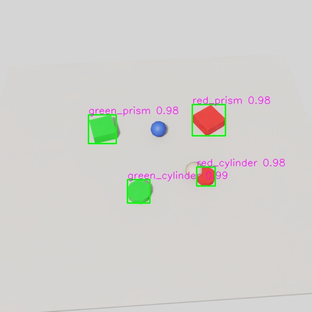

# Isaac Sim 전체 평가 — 2026-10-29

실제 Isaac Sim 6.1.0.0 RTX 렌더로 데이터셋을 생성하고 GPU 학습, 독립 test, 영상 추적, TensorRT, native ROS 카메라 연결을 실행했습니다. 실행 방법: [Isaac Sim](../docs/ISAAC_SIM.md), 향후 장비 연결: [RealSense](../docs/REALSENSE.md).

## 데이터·학습

4클래스 red_cylinder, red_prism, green_cylinder, green_prism. train 160 / val 40 / test 80장, 시험 GT 288개, 음성 이미지 8장입니다. 생성 seed·세션과 SHA256 기준 split 교차 중복이 없습니다. YOLOv8n을 50 epoch, batch 4, 640px, seed 317로 학습하고 val 기준 best.pt를 평가했습니다. test를 보고 epoch나 임계값을 조정하지 않았습니다.

| 모델 | Precision | Recall | mAP50 | mAP50–95 |
|---|---:|---:|---:|---:|
| 기존 2D 도형 학습 모델 | 0.670 | 0.569 | 0.550 | 0.459 |
| Isaac Sim 학습 모델 | 0.998 | 0.998 | 0.995 | 0.973 |

P/R은 Ultralytics 최대 F1 지점입니다. confidence 0.25에서 총 예측 상자는 290개이며 GT는 288개입니다. 음성 8장에서는 오검출 이미지 0장입니다. 음성에서 오검출이 없다는 것이 전체 이미지 오검출 0을 뜻하지 않습니다. 파일 입력 검출 지연시간 p50 5.45ms / p95 6.08ms, 평균 184.1 FPS(렌더링·저장·ROS 제외)입니다.

## 조건별 평가

| 조건 | 이미지 | mAP50 | mAP50–95 |
|---|---:|---:|---:|
| bright | 16 | 0.995 | 0.973 |
| dark | 16 | 0.995 | 0.979 |
| low_angle | 16 | 0.995 | 0.981 |
| normal | 16 | 0.995 | 0.982 |
| occlusion | 16 | 0.995 | 0.954 |

각 조건은 16장뿐이며 가림 조건이 가장 낮습니다. 조건명은 생성기의 설정 구분이고 실제 조도·가림률 범위를 포괄하는 보증이 아닙니다.

## 동영상·배포

- 별도 120프레임 영상, GT 480개 / 예측 480개 / IoU≥0.5 대응 480개, precision/recall 1.0.
- 물체별 ID 유지율 1.0, ID 전환 0회. 각 클래스에 물체가 하나인 제한된 영상이며 IDF1/HOTA 평가가 아닙니다.
- 추적 지연 p50 3.71ms / p95 4.79ms, 평균 256.6 FPS. 파일 읽기·렌더링·그리기·인코딩을 제외합니다.
- ONNX → TensorRT FP32/noTF32 출력 수치 비교 통과. 최대 절대 오차 0.000954, rtol 0.001 / atol 0.01.
- native Isaac Sim bundled Jazzy → Isaac ROS Lyrical 컨테이너: 40.007초 동안 검출 메시지 1,182개, 객체 4,728개, 결과 이미지 369개.
- 카메라 별도 12초 검사: RGB 121개, CameraInfo 359개, stamp와 frame_id가 일치하는 쌍 121개. fx/fy 732.9993, cx/cy 320.0. 이는 구독자가 수신한 개수이며 모든 렌더 프레임의 무손실 전달 보증은 아닙니다.
- 같은 정적 Sim 장면의 PyTorch ↔ ROS 상자 4개 모두 decoder 정수 절삭 기준 IoU 1.0. 소수 좌표 기준 IoU는 0.926–0.957로 원본 보고서에 함께 기록했습니다.
- CPU 회귀 검사 16개 통과.

[추적 결과 영상](sim-video/annotated.mp4)

## 증거와 한계

원본: [기준 모델](sim-baseline/evaluation.json), [새 모델](sim-trained/evaluation.json), [조건](sim-conditions/conditions.json), [영상](sim-video/video-evaluation.json), [ROS](sim-ros/ros-verification.json), [카메라](sim-ros/camera-verification.json), [상자 비교](sim-ros-box-comparison.json), [TensorRT](sim-trt-comparison.json), [테스트](sim-unit-tests.txt). 학습 CSV·인자, manifest, scene USD, 모델 해시도 reports에 보존했습니다. `sim-live-camera.json`의 receiver_verified=false는 렌더러 자체가 수신 판정을 하지 않는다는 뜻이고, 수신 증거는 별도 ROS/카메라 보고서입니다.

시험은 같은 생성 분포의 단순 절차적 물체입니다. 실사·실물 일반화, RealSense RGB/depth 정렬, 거리·6D 자세, 다중 동일 클래스 복잡 추적, 로봇 제어·충돌 물리, 장시간 부하를 검증하지 않았습니다. 실시간 ROS 테스트는 고정 장면 반복이므로 수신 메시지 개수를 인식 정확도로 해석하지 않습니다. RealSense는 연결 후 안내 절차에 따라 실제 세션 단위 분리 평가가 필요합니다.

모델·데이터·엔진은 로컬 산출물이며 Git에서 제외합니다. 생성 스크립트와 seed를 제공하되 GPU/Isaac Sim 버전에 따른 렌더 픽셀 완전 동일성은 보장하지 않습니다. 해당 엔진은 대상 GPU에서 재생성하세요.
