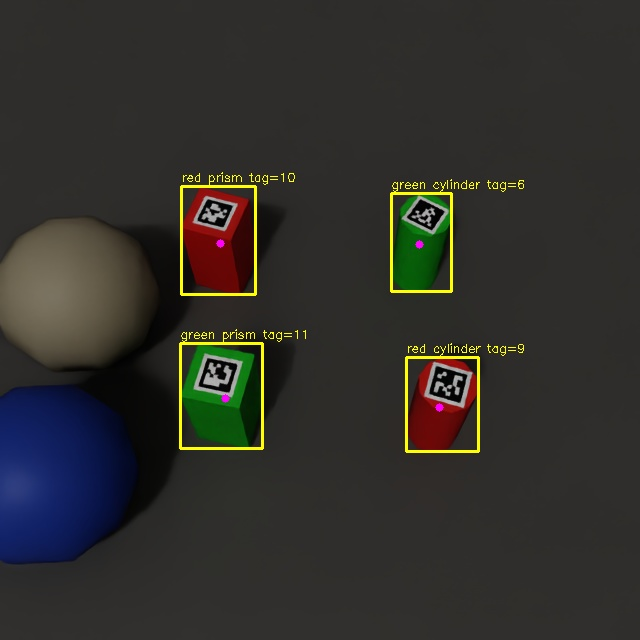

# 실규격 태그 퍽 최종 평가 — 2026-10-29

요청한 **30×30×60mm 직육면체, Ø30×60mm 원기둥**, 빨강·초록, 윗면 AprilTag를 실제 Isaac Sim 6.1에서 렌더링하고 학습·평가했습니다. [실행 안내](../../docs/TAGGED_PUCKS.md).

## 출력과 결과

| 기능 | 최종 독립 시험 결과 |
|---|---|
| YOLO 형상·색상 | mAP50 0.99436 / mAP50–95 0.99193 |
| CenterPose 영상 중심 | 오차 중앙값 0.53px / 95백분위 1.60px |
| CenterPose 3D 물체 중심 | 오차 중앙값 4.22mm / 95백분위 15.40mm |
| CenterPose 회전 | 90도 축 대칭 기준 중앙값 2.09° / 95백분위 6.09° |
| AprilTag ID | 360개 중 342개 대응(95%), 예상 밖 ID 0개 |
| AprilTag 3D 태그 중심 | 오차 중앙값 8.59mm / 95백분위 15.95mm |
| YOLO↔태그 연결 | 연결한 338건 중 올바른 연결 338건 |
| ByteTrack 영상 | 120프레임·GT 480개 모두 대응, ID 전환 0회 |
| 단위/회귀 검사 | 21개 통과, pip check 통과 |

CenterPose는 NVIDIA TAO DLA34 구조에 맞춤 crop 학습/추론 코드를 사용합니다. hm/hps/reg head를 학습하고, 예측 꼭짓점과 실제 치수로 PnP를 풉니다. 기본 Isaac ROS CenterPose decoder에 넣는 표준 export는 아닙니다. 태그로 얻은 중심을 CenterPose 결과로 대신 쓰지 않았습니다.

노란 상자는 YOLO, 자홍색 점은 CenterPose의 물체 중심 투영, tag 숫자는 검출된 AprilTag ID입니다. 실제 출력 좌표는 [JSON](example/perception.json)에 있습니다.

## 데이터와 평가 분모

train 240 / val 60 / test 100장, 독립 seed와 세션을 사용했습니다. train/val/test 이미지 SHA256 중복 검사도 통과했습니다. 시험에는 음성 이미지 10장과 물체 360개가 있습니다. 완전히 가려진 물체 2개는 렌더러의 보이는 2D 상자에서 빠져 YOLO GT 상자는 358개입니다. 3D pose·태그 평가는 가려진 물체도 포함한 전체 360개를 분모로 사용합니다.

CenterPose 오차는 같은 클래스·IoU≥0.5로 대응하고 수치 유효 검사를 통과한 **356개**에 대한 조건부 오차입니다. 태그 위치 오차는 검출된 342개에 대한 값이며, 미검출을 0 오차로 처리하지 않았습니다. YOLO P/R은 최대 F1 지점, 통합 추론은 confidence 0.25입니다. 음성 이미지 10장에서는 YOLO 오검출 이미지 0장이었습니다.

태그는 tag36h11 검은 경계 16mm, 흰 여백 포함 20mm입니다. ID를 장면마다 바꿔 색·형상과 고정적으로 연관되지 않게 했습니다. 물체 크기는 고정하고 위치·카메라·조명·가림을 바꿨습니다. 최종 태그 검출은 Apriltags3 CPU, 위치 추정은 OpenCV IPPE입니다. 검증 세트 비교 후 이 검출기를 선택했습니다.

| 시험 조건 | 태그 검출 / 전체 |
|---|---:|
| 정상 | 70 / 72 |
| 어두움 | 69 / 72 |
| 밝음 | 66 / 72 |
| 가림 | 66 / 72 |
| 낮은 각도 | 71 / 72 |

회전은 대칭 때문에 모호합니다. 대칭을 고려하지 않은 원래 축 기준 회전 오차는 중앙값 6.15° / 95백분위 93.55°입니다. 원기둥 축 방향만 비교하면 중앙값 0.79° / 95백분위 1.96°입니다. 고유 yaw가 필요하면 보이는 태그의 방향을 별도로 사용해야 합니다.

## 실시간 ROS 검증

실제 Sim native RGB·CameraInfo를 같은 stamp와 frame_id로 묶어 처리했습니다. 최종 모델로 655개 프레임, 2620개 물체 결과, 2620개 유효 CenterPose, 2620개 태그 연결을 기록했습니다. 동일 고정 장면 반복 테스트이므로 이 개수를 정확도로 해석하지 않습니다.

별도의 Lyrical 컨테이너 구독자는 `/pucks/perception` 메시지 537개를 수신했습니다. 동시에 NVIDIA cuAprilTag 노드에서 메시지 340개·태그 객체 1156개를 받았습니다. **GPU 경로는 실행·수신 확인이며 위 95% 정확도는 CPU Apriltags3 경로의 시험 결과**입니다. 기본 CenterPose 패키지는 설치했지만 이번 pose 추론은 호스트의 맞춤 DLA34 노드입니다.

## 수정 이력과 재현성

초기 USD `MakeVisible` 사용이 태그의 흰 배경 면을 숨기는 문제를 발견했습니다. 하위 픽셀·부모 표시 속성을 직접 설정하도록 수정했습니다. 흰 여백 자동 검사는 초기 데이터에서 실패, 최종 데이터에서는 통과했습니다. 이전 v3 수치는 최종 성능으로 사용하지 않습니다.

YOLO는 초기 데이터 50 epoch 후 수정 데이터에서 30 epoch 미세조정했습니다. CenterPose는 초기 40 epoch, 대칭 손실 60 epoch, 수정 데이터 30 epoch입니다. 각 단계 checkpoint는 val 기준으로 선택했습니다. 초기 결과를 본 뒤 대칭 처리·렌더링·검출기 개선을 수행했으므로 이 test는 개발 과정에서 재사용한 내부 시험 세트입니다. 독립적인 최종 수용 시험에는 새 seed/배치/실물 촬영 세트가 필요합니다. 태그 렌더 수정에 의한 개선과 모델 개선을 구분해 기록했습니다.

[모델·코드 해시](provenance.json), [학습 이력](centerpose-final-history.json), [생성 manifest](manifest.json), [USD 장면](scene.usda), [YOLO 평가](yolo/evaluation.json), [통합 오차 원본](combined/evaluation.json), [태그 조건별 평가](apriltags3-final.json), [ROS 수신](ros-topic-verification.json), [실시간 처리](live/live-report.json), [테스트](unit-tests.txt)를 보존했습니다.

가중치는 로컬 `runs/detect/tagged_pucks_v4/weights/best.pt`와 `models/centerpose-pucks-v4/best.pt`에 있으며 Git에서는 제외합니다. 전체 입력 데이터·venv·실시간 전체 JSONL도 로컬에 보존합니다. 저장소에는 재생성 코드와 대표 증거를 올립니다.

## 실제 사용 한계

640px 영상의 작은 태그, 가림·밝은 조명에서는 미검출과 mm 단위 위치 오차가 남습니다. 태그 없는 프레임은 null로, 모호한 대응은 ambiguous로 표시합니다. 정밀 집기에 필요한 허용 오차를 충족했다고 주장하지 않습니다. 실제 RealSense, 로봇 좌표계 보정, 실물 퍽 성능은 연결 후 검증해야 합니다. 깊이 영상의 한 픽셀 값은 보이는 표면까지의 거리이므로 물체의 기하 중심과 동일하지 않습니다.
